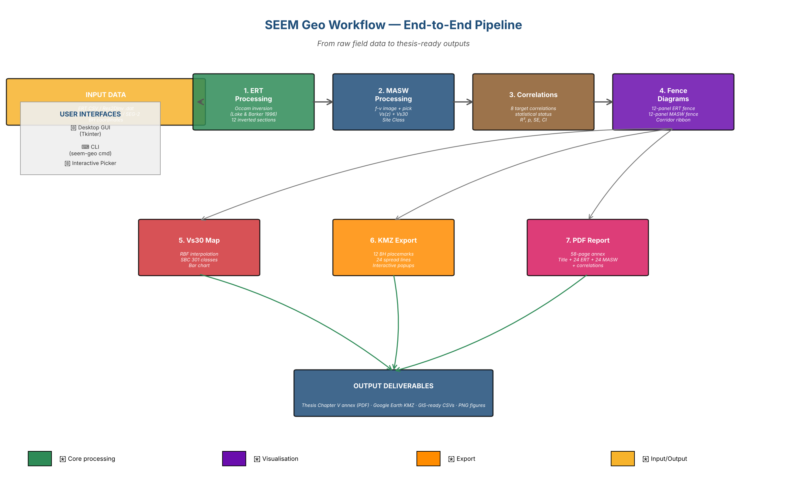

# SEEM Geo

**Professional ERT & MASW Processing Suite** for linear-infrastructure site investigations, built for linear-infrastructure site investigations.



---

## 🚀 Quick start

=== "GUI (recommended)"
  ```bash
  pip install seem-geo
  seem-geo gui
  ```

=== "Command line"
  ```bash
  seem-geo init --output my_project.seemproj
  seem-geo pipeline --project my_project.seemproj
  ```

=== "From source"
  ```bash
  git clone https://github.com/ahmedezz33/seem-geo.git
  cd seem-geo
  pip install -e .
  ```

---

## ✨ What it does

| Stage | Output |
|-------|--------|
| **ERT Processing** | Wenner pseudosection + Occam 2D inversion |
| **MASW Processing** | f-v image + Vs(z) + Vs30 + local-code Site Class |
| **Correlations** | 8 target correlations with statistical qualifications |
| **Fence Diagrams** | 12-site corridor visualization |
| **Vs30 Map** | Interpolated raster + bar chart |
| **KMZ Export** | Google Earth file with 36 interactive placemarks |
| **PDF Report** | 58-page thesis-ready annex |

---

## 📚 Documentation

- 📖 [User Guide (Arabic)](USER_GUIDE_AR.md)
- 📘 [Publishing to GitHub](PUBLISH_TO_GITHUB.md)
- 📝 [Changelog](CHANGELOG.md)
- 🤝 [Contributing](CONTRIBUTING.md)

---

## 📧 Contact

**Ahmed** · [your-email@example.com](mailto:your-email@example.com)

Open-source project
